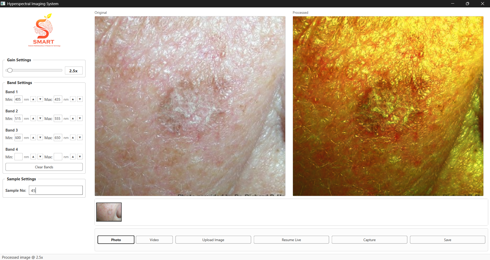

# Low Cost Hyperspectral Imager

A portable research prototype that uses an RGB camera and software processing to display a **spectral-style view** alongside the original image. The project combines an imaging interface, selectable wavelength bands, and a proposed Raspberry Pi 5 hardware setup. It is intended for experimentation and demonstration, not for clinical diagnosis or as a substitute for a calibrated hyperspectral camera.



## What the prototype does

The interface shown in the included screenshots provides:

- Side-by-side original and processed image views.
- Adjustable gain and four configurable wavelength-band slots.
- A sample number field and controls for Photo, Video, Upload Image, Resume Live, Capture, and Save.
- A Windows application and installer, plus launcher scripts for a Raspberry Pi version.

The example screenshot uses 405–435 nm, 515–555 nm, and 600–650 nm for the first three bands. These are user-selected processing ranges; an RGB camera does **not** directly measure a full spectrum at each pixel. Spectral fidelity depends on calibration and reconstruction data for the particular camera and lighting setup.

## How it is designed to work

The project report describes a Raspberry Pi 5 connected to a Camera Module 3 and a 7-inch display. Its proposed processing flow is:

```text
RGB camera or uploaded image
  → image preparation and camera calibration
  → RGB-to-spectral reconstruction
  → selected wavelength-band visualization
  → display beside the original image and save
```

The report bases the reconstruction concept on the Spectrum-Aided Vision Enhancer (SAVE) approach, which uses color calibration, a spectral reference, principal component analysis, and regression. Results quoted in the report from that underlying research are **not** independent performance measurements of this prototype. The included documentation identifies camera-specific calibration and hardware benchmarking as future work.

## Repository contents

| Path | Contents |
| --- | --- |
| [`Source Code/Windows/Source Code/main.py`](Source%20Code/Windows/Source%20Code/main.py) | Python entry point for the desktop interface. |
| [`Source Code/Windows/Application/`](Source%20Code/Windows/Application/) | Packaged Windows application. |
| [`Source Code/Windows/INSTALLER/`](Source%20Code/Windows/INSTALLER/) | Windows installer. |
| [`Source Code/Raspberry Pi/`](Source%20Code/Raspberry%20Pi/) | Linux and Windows launcher scripts. |
| [`Documentation/`](Documentation/) | Project report, presentation, and screen recording. |
| [`Screenshot/`](Screenshot/) | Two examples of the original and processed views. |
| [`execution.md`](execution.md) | Earlier interface and model-integration specification. |
| [`requirements.txt`](requirements.txt) | Python dependencies listed with the project. |

The video and Windows executables are stored with Git LFS. Install [Git LFS](https://git-lfs.com/) before cloning if you need those files locally:

```bash
git lfs install
git clone https://github.com/ArviZuko/Low-Cost-Hyperspectral-Imager.git
```

## Running the available build

On Windows, use the supplied installer at `Source Code/Windows/INSTALLER/HyperspectralImaging_Setup.exe` or the packaged application at `Source Code/Windows/Application/HyperspectralImaging.exe`. These binaries are included as provided; they have not been independently tested as part of this repository import. A working camera and any dependencies required by the packaged build may be needed.

The Python source snapshot is **not sufficient for a source installation**. Its entry point imports `ui.main_window` and `camera.camera_thread` from a sibling `shared` directory and checks for `weight.npz` and `cr_weights`. Those modules and calibration assets are not present in this repository. Installing `requirements.txt` alone will not make `main.py` runnable.

Likewise, the Raspberry Pi launchers reference `desktop_app/main.py`, which is not included here. The shell launcher also expects `libcamerify`. The report describes the Pi hardware prototype, but these files do not currently provide a complete reproducible Pi build.

## Documentation and credits

The [project report](Documentation/Low_Cost_Hyperspectral_Imaging_System_Project_Report.docx) explains the proposed hardware, calibration and reconstruction workflow, limitations, and future validation work. The [presentation](Documentation/Low_Cost_Hyperspectral_Imaging_System_15_Slide_PPT.pptx) provides a shorter overview. The report credits **Vedika Pangavhane** as the project author and **Dr. Arvind Mukundan** as guide/mentor at Sanjivani University.
